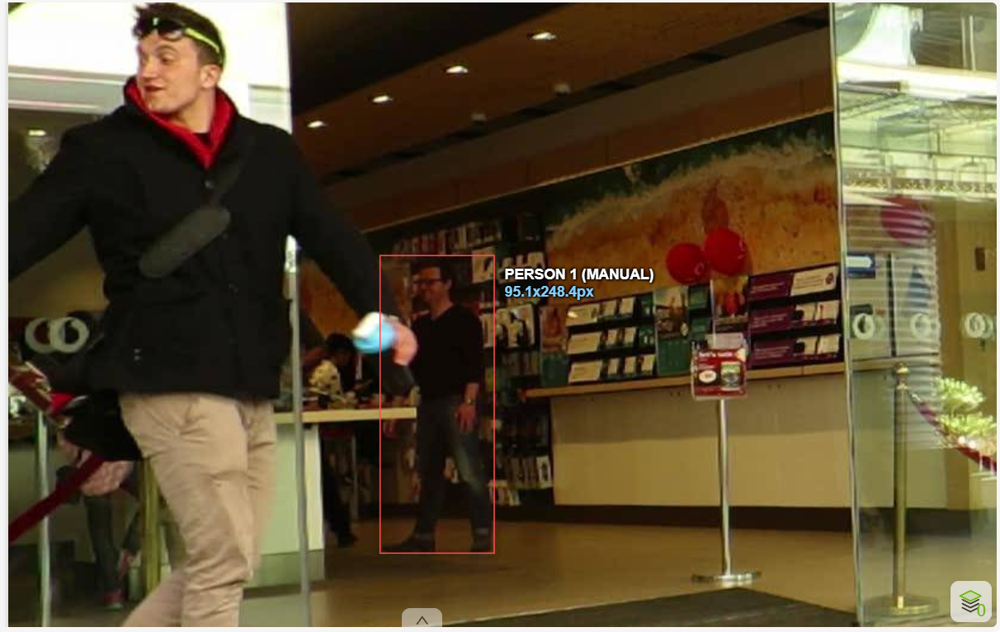
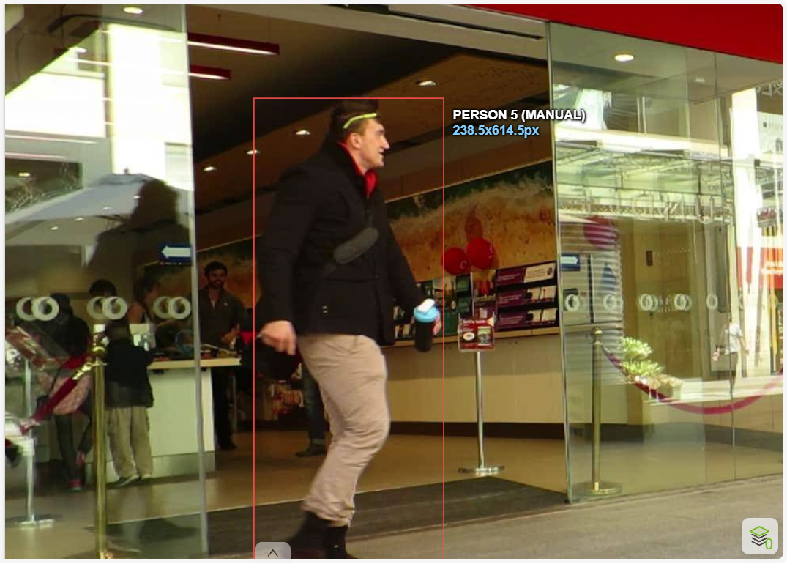
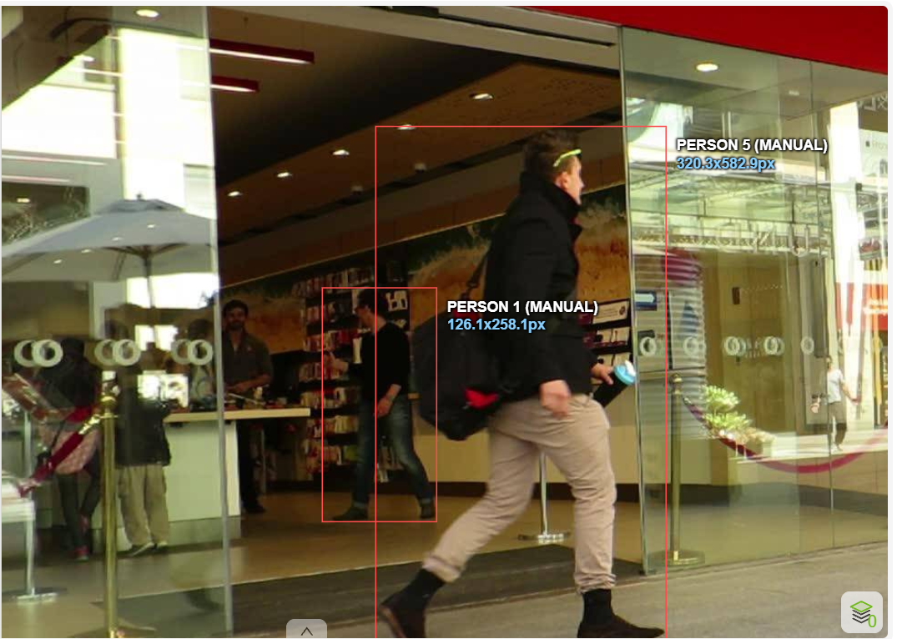

# Báo cáo cá nhân — TranGiaHuy-202603049

Đổi tên file theo quy tắc `MSSV_HoTen.md`. Ví dụ: `20241234_NguyenVanAn.md`.

Đoạn video: MOT17-09, 150 frame (frame 1–150), nguồn MOTChallenge, giấy phép CC BY-NC-SA 3.0.

## 0. Thông tin học viên

- Họ tên: Trần Gia Huy
- MSSV: 2A202603049
- Mã đề (A/B/C): C
- Email: 26ai.huytg2@vinuni.edu.vn
- Link repository: https://github.com/trngiahuyyyy/K5-L2-DAY05-TranGiaHuy-2A202603049-MOTTracking
- Giờ bắt đầu: 16:00
- Giờ kết thúc: 19:30

## 1. Xem trước đoạn video (CP0)

Ghi **trước khi vẽ**, mỗi người một dòng.

| Mã | Frame xuất hiện | Frame cuối thấy được | Rẽ / dừng / đổi tốc độ ở frame | Bị che ở frame | Ghi chú |
|---|---|---|---|---|---|
| P1 | 0 | 149 | Đứng yên 0–8, bước ra 9–20, chậm lại 20–25, đổi hướng khoảng 29–33, đi chậm lại 86–100, lại gần camera 140–149 | Che một phần 0–8, 26–38, 49–54, 100–111. Khuất hẳn 39–48 (10 frame) | |
| P2 | 61 | 149 | Đi sang phải 61–81, chậm dần 82–100, đổi hướng sang trái khoảng 120–126, lớn dần (lại gần camera) 112–149 | Che một phần 61–100 (40 frame), không khuất hẳn | |
| P3 | 40 | 149 | Vào từ mép phải 40, đi thẳng 65–90, lại gần camera nhanh 105–125, tăng tốc sang trái 126–139 | Bị mép khung cắt 40–64. Che một phần 40–64 theo cờ hiện tại | |
| P4 | 2 | 104 | Đi chậm sang phải 2–46, đứng gần như yên 47–89 | Bị người đi qua che 90–104. Khuất từ 105 | |
| P5 | 28 | 133 | Đi nhanh từ trái sang phải 28–62, đổi tốc độ 72–79, nhỏ dần (ra xa camera) suốt đoạn | Che một phần 110–117 và 129–133. Khuất hẳn 118–128 (11 frame), ra khỏi khung từ 134 | Di chuyển nhanh, kích thước thay đổi nhiều, gần camera |

## 2. Keyframe và thời gian (CP1, CP4)

Số keyframe lấy từ kết quả `src/check_submission.py`.

| Mã | Số keyframe | Keyframe ở frame | Số frame có mặt | Keyframe / 100 frame | Thời gian (phút) | Chỗ khó |
|---|---|---|---|---|---|---|
| P1 | 41 | 0, 8, 12, 13, 15, 19, 22, 26, 49, 52, 53, 54, 55, 56, 60, 61, 63, 67, 72, 75, 78, 83, 87, 88, 89, 92, 96, 97, 100, 103, 108, 110, 112, 117, 123, 127, 131, 139, 144, 147, 149 | 140 | 29.3 | 20 | ở các frame đầu khá là khó xác định tay chân |
| P2 | 22 | 61, 67, 75, 77, 79, 81, 93, 96, 98, 101, 105, 111, 116, 121, 125, 127, 131, 133, 136, 141, 146, 149 | 89 | 24.7 | 10 | Di chuyển tiến về trước mặt camera nên bbox hơi khó|
| P3 | 53 | 40, 44, 45, 46, 50, 53, 55, 56, 57, 58, 60, 65, 67, 68, 70, 71, 72, 73, 75, 76, 80, 85, 87, 89, 90, 91, 92, 93, 94, 95, 96, 97, 99, 100, 101, 104, 105, 106, 109, 110, 113, 114, 115, 119, 122, 125, 128, 129, 135, 139, 142, 145, 149 | 110 | 48.2 | 12 | Gần ngoài rìa nên key frame nhiều |
| P4 | 25 | 2, 3, 5, 7, 10, 12, 17, 22, 27, 32, 33, 37, 42, 46, 47, 52, 62, 72, 82, 90, 91, 92, 93, 95, 102 | 103 | 24.3 | 10 | bị che nhiều nên hơi khó phân định outside/occuded |
| P5 | 58 | 28, 32, 35, 36, 37, 38, 43, 44, 46, 48, 49, 50, 52, 53, 55, 56, 57, 58, 59, 60, 62, 64, 66, 67, 68, 71, 72, 74, 76, 77, 78, 80, 81, 82, 83, 84, 85, 88, 89, 91, 94, 95, 98, 99, 100, 102, 103, 104, 106, 108, 109, 110, 116, 117, 129, 131, 132, 133 | 95 | 61.1 | 30 | Do di chuyển nhanh, kích thước thay đổi liên tục và gần camera nên keyframe nhiều nhất |
| **Tổng** | 199 | — | 537 | 37,1 | 82 | — |

Keyframe / 100 frame của cả bài = tổng keyframe ÷ tổng số frame có mặt × 100 = 37.1 keyframe / 100 frame

Bạn đặt keyframe nhiều nhất ở người nào? Vì sao (người đó rẽ, dừng, lại gần camera hay bị che)?

   P5 đi nhanh, tốc độ, kích thước đổi liên tục và lại gần camera, nội suy tuyến tính không bám nên đặt keyframe dày, 61/100 frame

## 3. Đoạn bị che (CP2)

Người bị che: `P1`

| Mốc | Frame |
|---|---:|
| Bắt đầu bị che một phần (bật `occluded`) | 26 |
| Mất hẳn (bật `outside`) | 39 |
| Hiện lại (tắt `outside`) | 49 |
| Thấy rõ trở lại (tắt `occluded`) | 55 |

- Thời gian khuất hẳn: 10 frame (frame 39–48) = 0,33 giây (10 ÷ 30 fps).
- Quyết định: giữ cùng ID (cùng một track, ID 1 trong file MOT).
- Lý do (trả lời 3 câu):
  1. Khuất bao lâu so với 60 frame: chỉ 10 frame, thấp hơn nhiều so với ngưỡng 60 frame (2 giây) của lớp, nên theo quy ước là cùng ID.
  2. Ngoại hình có khớp: người hiện lại ở frame 49 mặc áo tối và quần jeans, cùng dáng với người trước khi khuất ở frame 38. Không có người nào khác trong cửa hàng giống như vậy ở chỗ đó.
  3. Chỗ hiện lại có đúng hướng và tốc độ cũ không: có. Box ở frame 38 và frame 49 gần cùng vị trí (tâm khoảng x = 390 và x = 387), người đang đi chậm quanh quầy nên không có chỗ nhảy bất thường.

Ảnh chụp màn hình:





## 4. Tự review ID (CP3)

Lượt 1 theo người (đi ngược từ frame 149 về 0 trên CVAT), lượt 2 theo cảnh (nhảy 10 frame). Ít nhất 3 dòng; không có lỗi thì ghi một dòng "đã kiểm hai lượt, không lỗi".

Loại lỗi dùng đúng một trong 7 mã: `id_switch`, `fragmentation`, `lost`, `merge`, `false_track`, `drift`, `flag`.

| Frame | Mã người | Loại lỗi | Mô tả một câu | Phát hiện ở lượt | Đã sửa? |
|---:|---|---|---|---|---|
| — | — | — | Đã kiểm hai lượt, không lỗi. | 2 | — |

Tổng hợp số lỗi theo loại:

| `id_switch` | `fragmentation` | `lost` | `merge` | `false_track` | `drift` | `flag` |
|---:|---:|---:|---:|---:|---:|---:|
| 0 | 0 | 0 | 0 | 0 | 0 | 0 |

Lỗi nào chỉ lượt 2 (theo cảnh) mới thấy, lượt 1 (theo người) không thấy? Vì sao?


## 5. File xuất và kết quả tự kiểm (CP4)

| Kiểm tra | Kết quả |
|---|---|
| Tên file MOT 1.1 | TranGiaHuy_mot.zip |
| Tên file CVAT for video 1.1 | TranGiaHuy_cvat_video.zip |
| Số track ID khác nhau trong `gt/gt.txt` (phải là 5) | 5 |
| Frame `outside` không có dòng trong `gt.txt` (đúng / sai) | đúng |
| Job đã completed trên CVAT máy cá nhân | 5 |

Dán phần tóm tắt in ra từ `src/check_submission.py`:

```
=== Tóm tắt ===
  Lỗi: 0   |   Cảnh báo: 1
  Không có lỗi định dạng. Mở CVAT xem lại từng [CẢNH BÁO]; cảnh báo đúng ý bạn thì ghi lý do vào báo cáo.
```
   Cảnh báo ở track 4 nhưng P5 đi nhanh, tốc độ không đều nên box đổi kích thước nhanh

## 6. Ba câu kết

1. Nếu được gán lại, bạn sẽ đặt keyframe khác ở đâu? Vì sao?

   Tôi sẽ bớt đặt keyframe ở những đoạn người di chuyển thẳng đều và bù lại vào những chỗ di chuyển nhanh chỉ trong vài frame, đi thẳng tới camera khiến cho người nhấp nhô

2. Có chỗ nào bạn không chắc "cùng ID hay ID mới"? Bạn đã quyết định và ghi chú thế nào?

   Không, tôi không chưa gặp trường hợp nào như thế.

3. Một lỗi ID trong job của bạn (nếu không còn sót, chọn lỗi đã sửa) có thể làm xe tự lái dự đoán sai chuyển động của người đó như thế nào? Lỗi đó ảnh hưởng MOTA hay IDF1 nhiều hơn?

   ID track = 4 trước đó tôi có nhầm bbox cả phần balo, sau khi Giảng viên bảo không bao gồm phần túi xách/balo tôi đã loại bỏ. Theo tôi lỗi này ảnh hưởng IDF1 nhiều hơn MOTA. 

## Bonus (nếu làm)

### B1 — Hai người đi sát

...

### B2 — So cách đặt keyframe

| Cách đặt | Số keyframe | Frame trôi nhất | Ghi chú |
|---|---:|---:|---|
| Đều mỗi 30 frame | | | |
| Theo chỗ đổi hướng | | | |

...

### B3 — So với tracker có sẵn

| Frame | Mã người | Tracker làm gì | Nhãn của bạn | Giải thích (đoán rồi sửa / ghép IoU / box score thấp / ngoại hình) |
|---:|---|---|---|---|
| | | | | |
| | | | | |

## 7. Tài liệu tham khảo và công cụ AI đã dùng

Claude.ai nhằm hỗ trợ check lỗi và các tài liệu do BTC cung cấp
